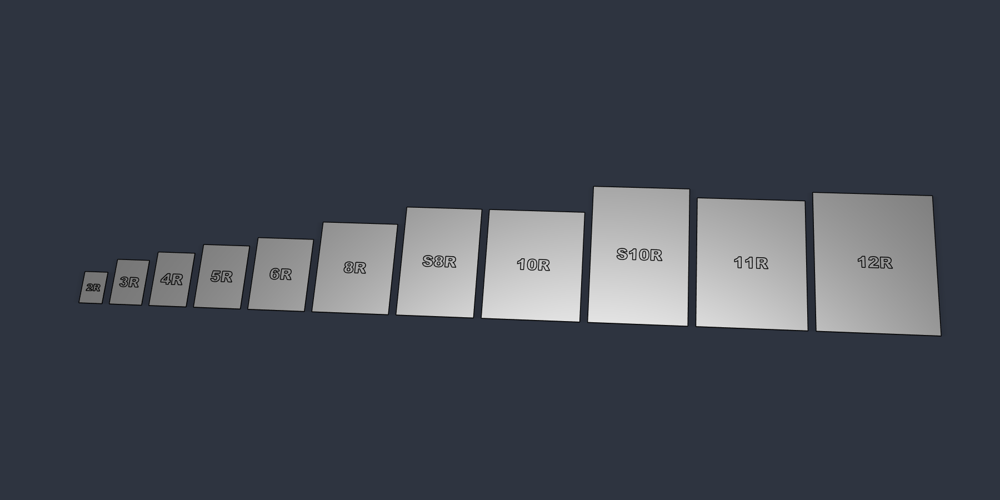
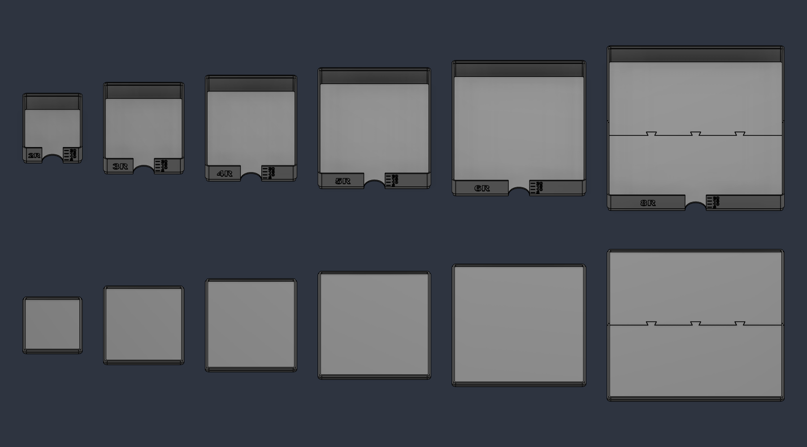
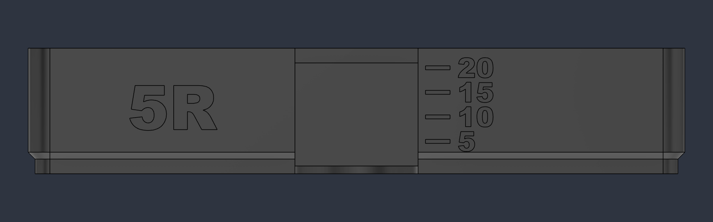
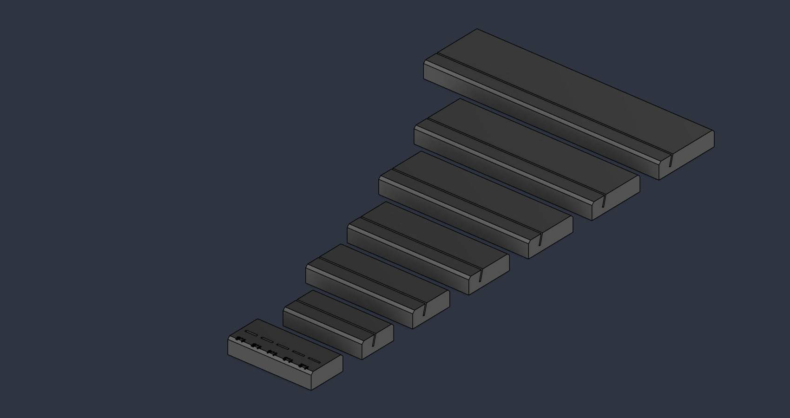
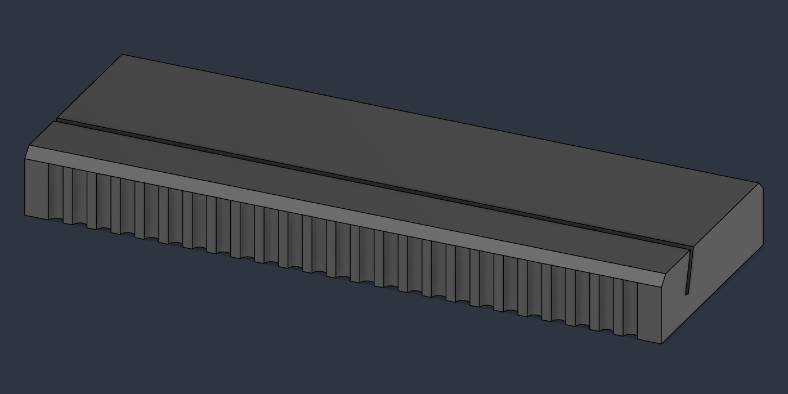
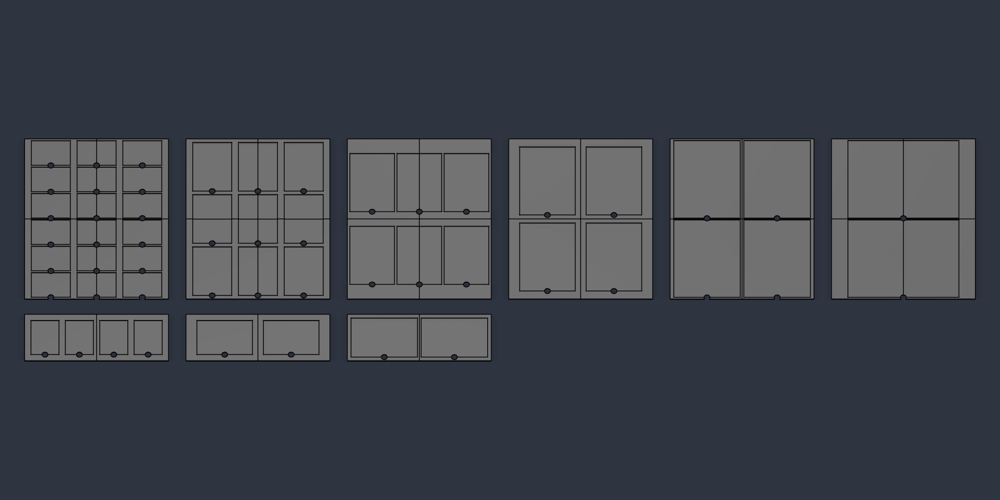

# Omni O1 Workshop

Photo-size blanks for UV printing, a stackable storage system for them, and the scripts that design,
slice and print it all: Autodesk Fusion driven by Claude over MCP, a Bambu Studio slicing pipeline with
versioned settings, and LAN control of a Bambu Lab P1S.



*Renders show the earlier labeled version; current blanks are plain.*

## What's in the repo

| Folder | Contents |
|---|---|
| `exports/blanks_1mm/` | 3MF models of the 11 standard photo sizes, plain 1 mm (no label) |
| `exports/storage_trays/` | 3MF models of stackable trays and lids (20 blanks each) for 2R to 8R |
| `exports/photo_stands/` | 3MF models of 15° slot stands in three styles (Minimal, Fluted, Rustic), plus slot-width test combs |
| `exports/storage_side_dispenser/` | 3MF models of the 2R side-dispenser tray, lid, spring sled and knob |
| `exports/o1_jigs/` | 3MF tiles of batch jigs and the registration frame for the xTool O1 Omni flat bed (small 330×122 and large 330×420 plates) |
| `exports/challenge_coins/` | 3MF challenge coin blank (1.75 in) for UV printing on both faces |
| `exports/bambu_projects/` | Bambu Studio projects: plates laid out with the settings used here, no G-code (see below) |
| `cad/` | Editable designs as STEP, which opens in Fusion and any other CAD program |
| `fusion/` | Fusion API scripts that generate every design from parameters |
| `slicer/` | Bambu Studio CLI pipeline, slicing recipes, P1S LAN control, and an MCP server for Claude |
| `docs/images/` | Renders |

## Photo blanks

All sizes are plain 1 mm slabs. There is no label: the storage trays carry the size, and a plain blank
diffuses light evenly (a debossed label thins the blank and shows through). Set `LABELS = True` in
`fusion/photo_blanks.py` to deboss the size name again.
Print them **on a smooth PEI plate**. The face against the plate comes out flat and smooth, and that is the face
you UV print the photo onto.

| Size | mm | inches | Fits a 256 mm bed (A1, P1S, P2S, X1C) |
|---|---|---|---|
| 2R (wallet) | 64 × 89 | 2.5 × 3.5 | yes |
| 3R | 89 × 127 | 3.5 × 5 | yes |
| 4R | 102 × 152 | 4 × 6 | yes |
| 5R | 127 × 178 | 5 × 7 | yes |
| 6R | 152 × 203 | 6 × 8 | yes |
| 8R | 203 × 254 | 8 × 10 | yes, edge to edge with no room for a brim |
| S8R | 203 × 305 | 8 × 12 | no (needs a ~320 mm bed) |
| 10R | 254 × 305 | 10 × 12 | no (needs a ~320 mm bed) |
| S10R | 254 × 381 | 10 × 15 | no (needs a 400 mm bed) |
| 11R | 279 × 356 | 11 × 14 | no (needs a 400 mm bed) |
| 12R | 305 × 381 | 12 × 15 | no (needs a 400 mm bed) |

Thin sheets bow more as they get bigger, so 1 mm is best suited to the smaller sizes. For 8R and up, test
1.5 to 2 mm (change `card_t` in the Fusion script) before committing to a batch.

## Storage trays



- Each tray holds 20 blanks flat, with 0.75 mm clearance per side.
- Trays stack: the inset foot of one tray drops into the rim of the tray below, and a lid caps the top of a stack.
- **Dispenser slot:** a slot one blank tall runs across the front at floor level, above the stacking joint.
  Push the bottom blank out through it with a finger in the rear notch, without unstacking anything. A solid strip
  above the slot holds back the rest of the stack (and prints as a clean bridge).
- A front notch above the slot shows the stack against tick marks at 5, 10, 15 and 20 (one blank is 1 mm).
- The 8R tray and lid are split in two with a dovetail seam so each half fits a 256 mm bed. Glue the halves with CA.
- Print trays upright and lids upside down, exactly as exported. No supports are needed. The slot bridge is
  65 mm on the 2R tray and grows to about 205 mm on 8R; test bridging on your printer before the big sizes.

*Renders show the earlier version without the dispenser slot.*

**Side dispenser (prototype, 2R):** `exports/storage_side_dispenser/` adds a sled in a floor groove and a
low-profile slider knob set into the right wall. Slide the knob forward 15 mm and the sled's 0.7 mm blade
pushes only the bottom blank about 10 mm out of the front slot; a short serpentine spring with round U-bends
returns it.
- **Knob:** its tab rides in a window through the wall, so the wall guides it. Outside there's only a thin grip
  plate with a thumb rib, about 3 mm proud. An arm runs under the floor to a T-head. Fit the knob through the
  window first, then drop the sled in: a T-slot through the sled closes around the head, so the knob can't fall
  out or pull free. (The first knob hung 7 mm off the wall on a loose tongue and tipped out of the sled.)
- **Slot:** 1.9 mm under a 3 mm strip, printed with reduced bridge flow so the 65 mm span sags less. Still
  under 2 mm, so the blank above stays put.
- **Spring:** no thin necks. It grows out of a rigid full-width header on the sled through a U-bend and ends in a
  U-bend into a rigid seat pad. Spring C (7 bars x 1.2 mm) won a hand test against two thinner, longer
  springs. Bar strain is roughly 3 x thickness x deflection / length^2, so thin bars and more of them last
  longer; thick, short springs are stiffer but wear sooner. PETG lasts longer than PLA.
- Checked in CAD for rest fit, the full stroke, stacking, knob capture and the assembly path.

**Button dispenser (v4):** `exports/storage_button_dispenser/` replaces the side slider, which still
jammed: it was pushed 11 mm off the sled's line with nothing to stop it twisting. The 2R tray passed hand
testing, and every size from 2R to 8R now uses the same design.
- **Sizes:** each size has its own tray and sled. The lever and button are the same part for every size,
  because the mechanism is placed from the right wall and the tray's mid-depth.
  - The 8R tray is too deep for a 256 mm bed. It's split by a dovetail seam 40 mm in front of centre, clear of
    the mechanism, so glue the two halves. Its 261 mm sled is exported lying across the bed diagonal.
  - Pressing force grows with the blank size, because the bottom blank carries the stack above it. Estimates
    for a full tray: about 6 N for 2R, 11 N for 4R, 19 N for 6R and 29 N for 8R (PLA on PLA, friction about
    0.35). It drops as the tray empties. 4R is the first larger size to test.

  | Size | Tray (mm) | Sled length (mm) |
  |------|-----------|------------------|
  | 2R | 70 x 95 x 32.5 | 96 |
  | 3R | 95 x 133 x 32.5 | 134 |
  | 4R | 108 x 158 x 32.5 | 159 |
  | 5R | 133 x 184 x 32.5 | 185 |
  | 6R | 158 x 209 x 32.5 | 210 |
  | 8R | 209 x 260 x 32.5 (two halves) | 261 |
- **How it works:** press a button on the right wall 5 mm and a bell-crank lever under the floor turns it into the
  sled's 15 mm (3:1). The parts meet only at a pivot and at pins in slots, so nothing is pushed off its own axis.
- **Layout:** the button runs in a closed tunnel through the wall. The lever lies above it in an open pocket under
  the blanks, with pins reaching down into the button and into an ear on the sled. The floor is 2.5 mm higher to
  stack all this.
- **Assembly:** push the button in from outside, drop the sled in (compressing its spring 5.5 mm), then lay the
  lever on its post. The lever's pin keeps the button in, and the blanks keep the lever down.
- **Spring D:** 0.3 N at rest and 1.1 N at full stroke, at 0.8% bar strain. Print the moving parts in PETG, which
  rubs with less friction and creeps less.
- **Test coupon:** the tray cut 15 mm high. It keeps the whole mechanism and holds a few blanks.
- **Open front, no slot bridge:** the 65 mm bridge over the old slot always sagged and left strings that caught
  the blank. The front is now open in the middle, and a stop grows out of each side wall: a 3 mm ledge, then a
  45° underside, so nothing needs a bridge. The bottom blank slides out under the stops, and the next one is
  caught by its corners. You can see the stack through the opening, so this version has no tick marks.
- **Front gap:** the ledge is drawn 2.2 mm above the floor and droops to about 1.7 mm when printed. On 4R test
  pieces, 2.0, 2.2 and 2.4 mm all let the bottom blank out and held the next one. The full 4R tray at 2.0 was
  tight, so every size uses 2.2 for margin.
- **Pins:** 5 mm (button) and 4 mm (sled), with rounded roots. The first 3 mm pins snapped, because they print
  standing up.



## Photo stands



- A 15° slot holds the plaque by its bottom edge. Bases reach about 15% of the plaque height behind the slot so
  tall plaques don't tip. Each stand is labeled in inches on the back (2.5x3.5 up to 8x10).
- Three styles on the same footprint:
  - **Minimal**: smooth with chamfered edges.
  - **Fluted**: vertical ribs across the front.
  - **Rustic**: the minimal shape printed with fuzzy skin (Perlin noise) on the outside for a stone or
    weathered look; best in wood-fill or marble PLA. Its slot has end walls, so the slicer treats it as a hole
    and contour-only fuzzy skin leaves it smooth at the plain width.
- **Slot width: 3.1 mm**, for UV prints with raised resin texture. A 1 mm blank plus 1 mm or more of texture is
  2 mm+. Of the 2.5, 2.8 and 3.1 mm test stands, all held the prints, and 3.1 leaves room for thicker resin layers.
- For plain 1 mm blanks, set `SLOT_W = 1.4` in `fusion/photo_stands.py`, checked with the plain test comb
  (1.2–1.6 mm). The Textured comb (2.2–3.4 mm) and test stands are there to re-check other textures. The Rustic
  comb is only needed if you fuzz every wall.
- Print upright as exported, no supports. Matte PLA hides layer lines.



## Challenge coins

A 1.75 in (44.45 mm) challenge coin blank, 3 mm thick, for UV printing artwork on both faces.
- **Faces:** both flat. The bottom face prints glossy on smooth PEI, and the `challenge_coin` recipe irons the
  top face.
- **Infill:** 100%, so the coin feels solid (about 5.7 g in PLA). White PLA gives the UV inks a true-colour base.
- **Edge:** 0.4 mm chamfers on both faces and a 90-groove reeded edge, so it feels like a struck coin.
- `fusion/challenge_coin.py` builds it. Set `SIZES` for the other common sizes (1.5 in, 2 in), and `REEDS = 0`
  for a plain edge.

## Batch jigs for the xTool O1 Omni



Flat-bed jigs for 1 mm photo blanks, for both O1 plates. xTool's manual calls the plates mini and standard;
its product page calls them standard and large. By size:

| Blank | Small plate, 330 × 122 mm | Large plate, 330 × 420 mm |
|---|---|---|
| 2R (2.5x3.5 in) | 4 | 18 |
| 3R (3.5x5 in) | 2 | 9 |
| 4R (4x6 in) | 2 | 6 |
| 5R (5x7 in) | - | 4 |
| 6R (6x8 in) | - | 4 |
| 8R (8x10 in) | - | 2 |

- Pockets are 0.9 mm deep, so a 1 mm blank sits 0.1 mm above the jig and the O1's height sensing lands on
  the blanks, all on one plane. 0.2 mm clearance per side, corner reliefs, and a finger notch per pocket.
- Jigs cover the print area and are cut into tiles that fit a 256 mm printer bed, with seams placed in the walls
  between pockets where possible. Butt the tiles together on the plate (or glue them with CA).
- Print in **matte black** PLA: plain and matte so the O1's scan picks out the white blanks.
- **12x12 in acrylic sheet (large plate):** a frame, not a pocket plate. The sheet lies on the mat, centred,
  inside a 2.7 mm frame. The frame is thinner than any 1/8 in sheet (they measure 2.8–3.2 mm), so the O1's
  height sensing lands on the acrylic.
  - The opening is 304.8 mm + 0.3% for the frame's shrink + 0.2 mm per side. There's a finger notch at the
    front.
  - Four L-shaped tiles (two plates) butt together inside the edge clips' window. With no floor it takes about
    120 g, not a 300 g slab.
  - It comes from the same generator: an `ITEMS` line with `{'floor': 0.0}`.
- Calibrate once: tape over the jig, print the template, measure the offset, correct it in xTool Studio.
- **Clips that lock frames to the plate:** straight C-clips, each printed lying on its C profile. Both jaws are
  part of the flat outline, so there are no overhangs and no supports, and the jaws bend along the layers, the
  strong direction. (One-piece clips printed upright needed 7 mm overhangs and nearly failed.) Each top jaw lies on
  the mat, and each hook goes under the plate, so a bump can't lift a clip.
  - **Large plate:** eight identical edge clips, two near each corner, 50–90 mm from it. That keeps them clear of
    the mat tab and of the spring latches at the middle of the long sides. Their top jaws reach the print area,
    so together they form the 330 × 420 window for jigs and acrylic sheets. The plate is 344 × 434 × 16.6 mm.
  - **Small plate:** the frame halves (below) locate the jigs, and one end clip per end holds a half down. Its
    jaw clamps the half's end lip, and its hook goes under the plate's 7.5 mm end lip. Slide it on from the end,
    centred.
  - `o1_clips` recipe: a brim, because the clips stand 40–50 mm tall while printing, plus solid infill and four
    walls.

- **Frame halves (small plate):** two identical halves drop over the plate, one on each end (turn the second
  half around), and the end clips hold them.
  - Skirts hug the end, the rounded R4 corners, and the front and back faces.
  - The window is the print area plus 0.3 mm, so any jig drops in at the same spot. Swap jigs by lifting one out
    and dropping the next in.
  - Tab reliefs clear the mat's pull tab either way round.
  - Print lip-down, as exported: no overhangs.

- **Acrylic sheet corner drill guide:** for mounting holes 1 in from both edges of 12x12 in acrylic sheets. One
  guide does all four corners.
  - Two lips hook the sheet's edges at a corner. Drill a 1/8 in pilot through the guide hole, move to the next
    corner, then open the pilots up to screw size.
  - The lips are 2 mm deep, shorter than a 1/8 in sheet, so the guide sits flat with the sheet on the bench. A
    relief at the inside corner lets a burred corner seat.
  - Print it top-face down, lips up, as exported (`drill_jigs` recipe). For another hole spacing, bit or sheet
    thickness, edit the constants at the top of `fusion/acrylic_drill_jig.py`.

`fusion/o1_jigs.py` generates jigs for any flat rectangular item: add a line to `ITEMS`. `fusion/o1_frame.py`
builds the small-plate frame halves, and `fusion/o1_clips.py` the clips for both plates.

## Printing on Bambu Lab printers

The repo ships **Bambu Studio project files, not G-code**. G-code is specific to one printer, nozzle and
plate, and a file sliced for someone else's setup can crash a nozzle or cook a bed. A project file carries the
models laid out on plates plus the settings used here (presets, overrides, gyroid infill). Open it in Bambu
Studio, check the printer, filament and plate, slice, and print. The settings come from `slicer/recipes/`.

| Project in `exports/bambu_projects/` | Plates | Time | PLA | Build plate |
|---|---|---|---|---|
| `Photo blanks 2R-8R 1mm` | 3 | ~3.2 h | ~170 g | Smooth PEI |
| `Storage trays and lids 2R-8R` | 8 | ~18 h | ~960 g | Textured PEI |
| `Side dispenser 2R set X1C` (tray, lid, spring sled, knob) | 1 | ~80 min | ~62 g | Textured PEI |
| `Slot test comb` / `Slot test comb Rustic` / `Slot test comb Textured` | 1 each | ~30 min | ~17 g | Textured PEI |
| `Photo stands Minimal / Fluted / Rustic 2R-8R` | 1 each | ~3.9 / 4.7 / 4.9 h | ~225 g | Textured PEI |
| `O1 Small jig <size>` (2R x4, 3R x2, 4R x2) | 1 each | ~1.2 h | ~55-65 g | Textured PEI, matte black |
| `O1 Large jig <size>` (2R-8R) | 3-4 each | ~3.5-4 h | ~160-205 g | Textured PEI, matte black |
| `O1 Small frame halves x2` | 2 | ~25 min each | ~14 g each | Smooth or textured PEI, black |

Projects are set up for a P1S (or an X1 Carbon where named), 0.4 mm nozzle. Bambu Studio switches them to
another Bambu printer when you change the printer. Times and weights are from the last slice here. For
other slicers, use the 3MF models in `exports/` with your own profiles.

## Regenerating the models in Fusion

The scripts in `fusion/` use the Fusion API and define `run(context)`. Run them from Fusion
(Utilities → Scripts and Add-Ins → create a Python script and paste the file in) or through an MCP client
connected to Fusion's built-in MCP server.

- `photo_blanks.py` builds all 11 blanks in the active design. Every dimension is a user parameter.
- `storage_trays.py` builds every tray and lid in a new document and splits parts that exceed the bed.
- `place_blanks_in_trays.py` copies the blanks into their trays as a fit check.
- `photo_stands.py` builds the slot stands (three styles) and the slot-width test combs in a new document.
- `o1_jigs.py` builds tiled batch jigs for the xTool O1 Omni in a new document.
- `o1_frame.py` builds one half of the small-plate registration frame (print two), with a fit check against a
  stand-in plate and jig.

The scripts are the parametric source: change a parameter and rerun them to get the design with its full
timeline. To edit a solid directly, open its STEP file from `cad/` in Fusion or any other CAD program.
Fusion archives (`.f3d`) are not published, because Fusion embeds account details in them.

## Slicing pipeline and MCP server

`slicer/` slices from **recipes**: a recipe names three Bambu system presets (machine, process, filament)
and overrides individual settings, each with a dated reason in its changelog. Every slice and every recorded
print outcome is appended to a local journal, so settings can be tuned against real results.

```
cd slicer
pip install -r requirements.txt
python bambu_slice.py slice photo_blanks_1mm "../exports/blanks_1mm/5R*.3mf" --job "5R test"
python bambu_slice.py set photo_blanks_1mm process brim_type brim_ears "corners lifted on 8R"
python bambu_slice.py result "5R test" ok "flat, clean photo face"
python bambu_slice.py project photo_blanks_1mm "../exports/blanks_1mm/5R*.3mf" --job "5R blanks"
```

`DEFAULTS` in `bambu_slice.py` applies pipeline-wide settings under every recipe (currently gyroid infill). A
recipe that sets the same key wins. Sliced `.gcode.3mf` files go to `exports/sliced/`, which stays local
(git-ignored). `project` writes the shareable version, with no G-code, to `exports/bambu_projects/`.

**Bambu Studio CLI gotcha.** The CLI ignores `inherits` and `include` in preset files passed with
`--load-settings`. It silently falls back to built-in defaults, so you get G-code **with no printer start
sequence and no bed leveling**, zero filament density and wrong bed temperatures. `bambu_profiles.py` resolves
the system presets the way the GUI does, and every sliced plate is checked for the printer's start G-code,
G29 bed leveling and objects inside the bed before it is marked safe to print.

`bambu_mcp.py` exposes all of this to Claude as an MCP server: recipes, settings search and tuning, slicing,
the print journal, and P1S status, camera snapshots, chamber light, and a guarded print start (always a dry
run first, then an explicit confirm). Register it with Claude Code:

```
claude mcp add --scope user bambu -- <path-to-python> <path-to-repo>/slicer/bambu_mcp.py
```

Printer credentials are read from the OS keychain (Windows Credential Manager on Windows), never from files:

```
python -c "import keyring, getpass; [keyring.set_password('omni-o1', 'p1s_' + k, getpass.getpass(k + ': ') if k == 'access_code' else input(k + ': ')) for k in ('ip', 'serial', 'access_code')]"
```

Status and camera work while the printer is on Bambu Cloud. Uploading and starting prints from your own code
needs the printer in **LAN-only mode with Developer Mode on** (Bambu's 2025 authorization firmware), which
disconnects it from Bambu Cloud and Bambu Handy.

Both a P1S and an X1 Carbon are supported: store credentials under `p1s_*` / `x1c_*`, slice any recipe for either
printer (`--printer x1c`, which swaps in that printer's machine and filament presets), and pass `printer=` to the
print and status tools. A file sliced for one printer model is refused by the other.

## Home Assistant

`homeassistant/blueprints/` holds automations for the [ha-bambulab](https://github.com/greghesp/ha-bambulab)
integration that you can import with one click.

**Print finished / failed: phone alert with photo.** Saves a printer camera snapshot to `/config/www` and pushes
it to your phone (Home Assistant Companion app) with the job name and filament weight.

[](https://my.home-assistant.io/redirect/blueprint_import/?blueprint_url=https%3A%2F%2Fgithub.com%2Fbyoungster%2Fomni-o1-workshop%2Fblob%2Fmain%2Fhomeassistant%2Fblueprints%2Fautomation%2Fbambu_print_alert_photo.yaml)

## Roadmap

- Home Assistant as the hub: ESP32 camera and LED status lights, more automations
- Slack bot: request a design in Slack, approve it, and get a photo back when the print finishes
- O1 large-plate registration frame; jigs for magnets, ornaments, badges, phone cases
- Automated plate handling

## License

- Code (`fusion/`, `slicer/`): [MIT](LICENSE)
- Models, print files and images (`exports/`, `docs/images/`): [CC BY-NC-SA 4.0](LICENSE-MODELS.txt).
  Credit this repo, no commercial use, and share changes under the same license.
